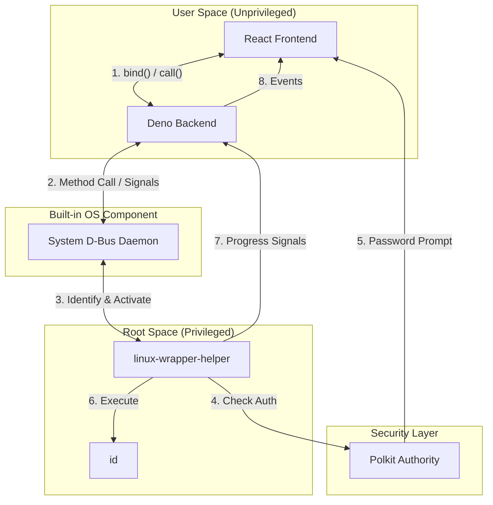

# Linux Wrapper Starter

Blueprint for building secure *GUI Linux applications with access to root* commands. 
This starter demonstrates how to perform privileged (root) and unprivileged 
operations from a Deno Desktop GUI (WebView) using the `D-Bus` system bus and `Polkit`.


## Tech Stack

- **[Deno Desktop](https://docs.deno.com/runtime/manual/basics/desktop)**: The runtime for the backend and the WebView container (`Deno.BrowserWindow`).
- **[React](https://react.dev/)**: The frontend framework for the interactive notebook UI, managed natively by Deno.
- **[D-Bus](https://www.freedesktop.org/wiki/Software/dbus/)**: The standard Linux message bus used for unprivileged-to-privileged communication.
- **[Polkit](https://www.freedesktop.org/software/polkit/docs/latest/)**: The Linux authority for managing system-wide privileges and password prompts.
- **[dbus-next](https://github.com/dbusjs/node-dbus-next)**: The high-performance TypeScript library for D-Bus integration in Deno.
- **[nfpm](https://nfpm.goreleaser.com/)**: A simple, 0-dependency deb, rpm, apk and arch linux packager.

## Development Mode (GUI in browser)

1. **Install prerequisites**: `deno` and `dbus`.
2. **Install the privileged helper**:
   ```bash
   deno task helper:install
   ```
   *This compiles the helper and installs system-wide configuration files (requires sudo). See [Privileged Helper](#privileged-helper) for details.*
3. **Run the application** (starts the Vite frontend and the Deno backend):
   ```bash
   deno task dev
   ```

## Build Application (GUI in WebView)

You can build native Linux packages (`.deb` or `.rpm`) that bundle the application, the privileged helper, and all required system configurations.

### 1. Generate Packages
Each package task automatically builds the frontend and compiles the binaries first.

Generate a Debian package:
```bash
deno task package:deb
```
Or an RPM package:
```bash
deno task package:rpm
```

### 2. Installation
Install the generated package using your system's package manager:

**Ubuntu/Debian:**
```bash
sudo apt install ./linux-wrapper-starter_0.1.0_amd64.deb
```

**Fedora/RHEL:**
```bash
sudo dnf install ./linux-wrapper-starter-0.1.0-1.x86_64.rpm
```

The package automatically installs the privileged helper to `/usr/libexec`, configures D-Bus and Polkit, and adds a desktop entry to your application menu.


## Architecture


## Privileged Helper

To perform root(sudo) operations securely, this project uses a background helper service.

### Installation Details

When you run `deno task helper:install`, the following actions are performed:
1.  The helper is compiled into a standalone binary at `dist/linux-wrapper-helper`.
2.  The binary and configuration files are installed to system directories (requires `sudo`):
    - **Binary**: `/usr/libexec/linux-wrapper-helper`
    - **D-Bus Service**: `/usr/share/dbus-1/system-services/org.linux_wrapper_starter.Helper1.service`
    - **D-Bus Policy**: `/etc/dbus-1/system.d/org.linux_wrapper_starter.Helper1.conf`
    - **Polkit Policy**: `/usr/share/polkit-1/actions/org.linux_wrapper_starter.Helper1.policy`
3.  The D-Bus daemon is reloaded to apply the new configuration.

### Uninstallation

To remove the helper and all associated system configuration files, run:
```bash
deno task helper:uninstall
```
This will delete the files listed above and reload the D-Bus daemon.
